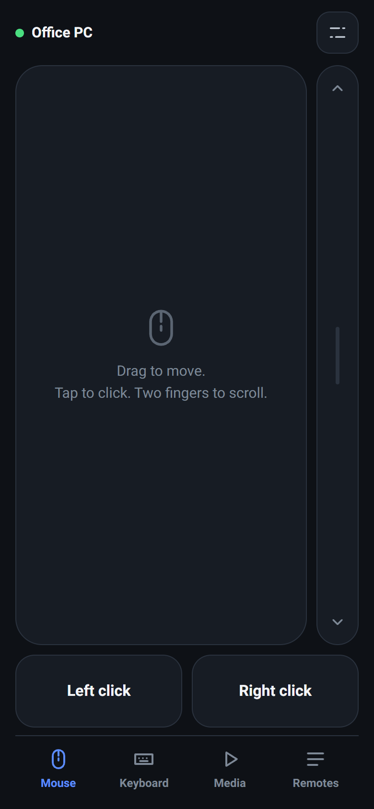
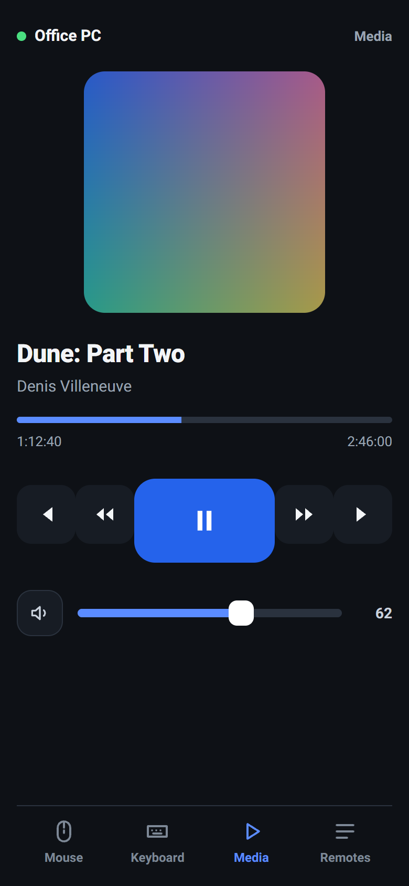
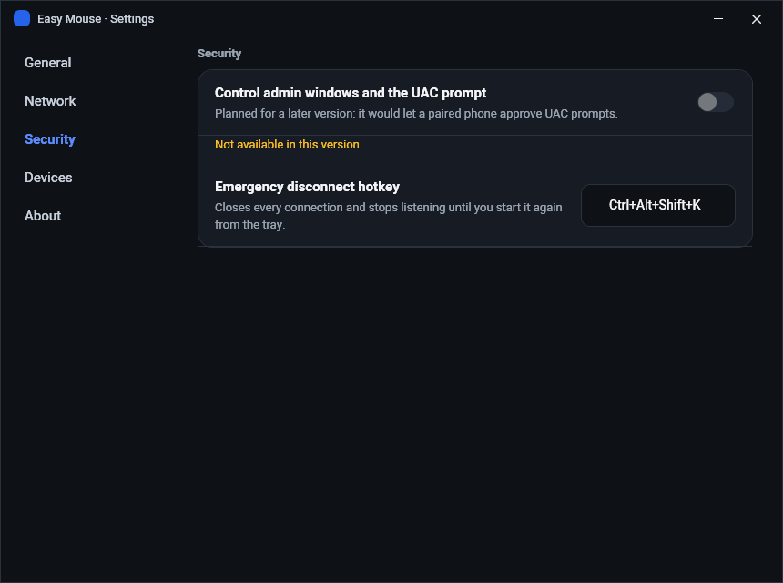

# Easy Mouse

Turn your phone's browser into a mouse, keyboard and media remote for your Windows PC.
Nothing to install on the phone, and nothing leaves your local network (apart from an optional,
once-a-day update check, see [Privacy](#privacy)).

> **Early release (0.1).** It works, but it is young. Please read [Limitations](#limitations).

| Phone: mouse | Phone: media | PC: Settings |
| --- | --- | --- |
|  |  |  |

The phone screenshots are the real web app at 390x844 running against the development
mock server in [`web/dev`](web/README.md) (so the track shown is fake data). The Settings
screenshot is the real window.

## How it works

1. Start Easy Mouse on the PC. A small window shows a QR code.
2. Scan it with the phone camera. The remote opens in the phone's browser.
3. Click **Allow** on the PC, once. The phone is remembered and reconnects by itself later.

Only one phone controls the PC at a time. You can disconnect every phone at once from
the tray or with an emergency hotkey (default `Ctrl+Alt+Shift+K`).

## What it does today

- **Mouse:** touchpad with tap, two-finger tap, two-finger scroll, tap-and-hold to drag, left and right click.
- **Keyboard:** type text and send common keys from the phone.
- **Media:** play, pause, skip, volume, and the current title and cover art from Windows.
- **Hebrew and English** in both the PC app and the phone app, with right-to-left layout.
- **PC app:** tray icon, approve or revoke phones, optional start with Windows, network hints.

## Requirements

- Windows 11 (see [Limitations](#limitations) for Windows 10).
- A phone with a current browser (Android or iPhone) on the **same Wi-Fi** as the PC.
- The Wi-Fi network must be set to **Private** in Windows. Windows blocks other devices on
  Public networks. If it is Public, Easy Mouse tells you and offers a "Make network Private"
  button (Windows asks for permission for that one change).

## Install and pair

1. Go to the [Releases page](https://github.com/bustrama/easy-mouse/releases) and download
   the latest release. *(If there is no release there yet, nothing has been published;
   see [CONTRIBUTING.md](CONTRIBUTING.md) to build from source.)*
2. Verify the download (see below), then run it. The build is unsigned, so Windows
   SmartScreen will warn you.
3. Start Easy Mouse. Scan the QR code with your phone, then click **Allow** on the PC.

If the phone cannot connect, the QR window shows the address it is listening on
(`http://<PC address>:<port>`, default port 8765) and the network hints explain what to fix.

### Verify the download

Releases are not code-signed yet. Before running a file:

- Download it only from this repository's Releases page.
- Compare its SHA-256 with SHA256SUMS on the release page, which is signed (SHA256SUMS.sig, Ed25519, see [docs/releasing.md](docs/releasing.md#verifying-a-release-you-or-a-user-who-wants-to)):

  ```powershell
  Get-FileHash .\<downloaded file> -Algorithm SHA256
  ```

- You can also read the source and build it yourself, see [CONTRIBUTING.md](CONTRIBUTING.md).

SmartScreen shows "Windows protected your PC" for unsigned apps. Only choose
**More info > Run anyway** if the file came from the Releases page and the hash matches.

## Limitations

- **Admin windows, the UAC prompt and the lock screen cannot be controlled.** Windows blocks
  input from a normal app there. The Settings option "Control admin windows and the UAC
  prompt" is shown disabled ("Not available in this version"); it is planned, not built.
  Easy Mouse never unlocks the PC and never stores your Windows password.
- **Windows 10 is untested.** It may work; nobody has checked.
- **Remotes are limited.** The phone has a Remotes tab and the remote format and built-in
  definitions (Plex, Stremio, VLC, browser video) exist in this repository, but the PC app does not
  load them yet, so the tab is mostly empty. There is no phone-side remote editor yet.
- **Unsigned build.** SmartScreen warns, see above.
- **Local network only, plain HTTP.** Traffic is end-to-end encrypted by the pairing
  protocol, but this is not a substitute for a trusted network. See [docs/security.md](docs/security.md).
- No PWA / "install to home screen" support.

## Privacy

No cloud, no accounts, no telemetry, no analytics. Easy Mouse listens only on your local
network and talks only to phones you approved. The phone web app is served by the PC itself;
nothing is loaded from a CDN. Paired devices and settings are stored on your PC.

### Updates

Easy Mouse can check for updates, and this is the **only** thing it does over the internet. Once a day
(and when you click **Check now**) it asks `api.github.com` whether a newer release exists. The request
is a plain GET with the generic user agent `EasyMouse-Updater`; it carries no account, device or version
information. If there is a newer version, the tray and Settings say "Update available". Nothing is
downloaded or installed without you clicking **Update** and confirming. The download comes from
`github.com`, its signature (Ed25519) and SHA-256 are verified before the installer runs, a version that
is not newer is refused, and Windows asks for your permission. Switch it off in Settings, Updates.
Details and the threat model: [docs/security.md](docs/security.md#updates).
## Docs

- [Architecture](docs/architecture.md)
- [Security and threat model](docs/security.md)
- [Wire protocol](docs/protocol.md)
- [Releasing](docs/releasing.md) (how a release is cut and signed)
- [Contributing](CONTRIBUTING.md)
- [Design source](design/)

Report vulnerabilities privately, see [SECURITY.md](SECURITY.md).

## Licence

[MIT](LICENSE)
